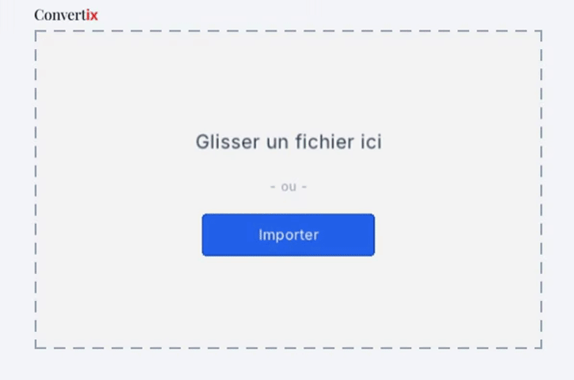
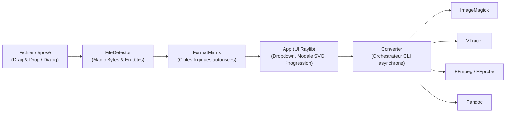

<p align="center">
  
</p>

<p align="center">
  <strong>Convertisseur de fichiers universel, 100 % hors-ligne et ultra-léger en C++17 & Raylib.</strong><br/>
  <em>Glissez. Choisissez. Convertissez.</em>
</p>

<p align="center">
  
  
  
  
  
</p>

<p align="center">
  <a href="#-aperçu">Aperçu</a> •
  <a href="#-fonctionnalités-clés">Fonctionnalités</a> •
  <a href="#-matrice-des-formats">Formats supportés</a> •
  <a href="#-architecture--moteurs">Architecture</a> •
  <a href="#️-compilation--installation">Compilation</a>
</p>

---

## ✨ Aperçu

**Convertix** est une application de bureau native pensée pour convertir n'importe quel fichier (**Image**, **Audio**, **Vidéo**, **Document**) en quelques secondes par simple glisser-déposer (*Drag & Drop*), localement, sans ralentir votre machine.
<p align="center">
  
</p>
---

## Fonctionnalités clés

### Inspection binaire (`FileDetector`)
Identification des signatures binaires (*PNG, JPEG, WEBP, GIF, BMP, ICO, TIFF/RAW, HEIC, WAV, FLAC, OGG, MP3, AAC, MP4/MOV/M4A, MKV/WEBM, AVI, PDF, PKZIP/DOCX/ODT*) combinée à l'analyse structurelle XML/HTML/UTF-8.

### Cloisonnement logique (`FormatMatrix`)
Seules les cibles pertinentes sont proposées dans le menu déroulant, avec une passerelle dédiée pour l'**extraction audio depuis une vidéo**.

### Vectorisation matricielle via VTracer
- Transformation directe d'images matricielles (logos, icônes, illustrations) en tracés vectoriels multicouleurs (`--colormode color --hierarchical stacked`).
- Normalisation couleur 32-bit RGBA (`sRGB`)
Pré-traitement automatique sans perte des formats complexes (`WEBP`, `BMP`, `TIFF`, `ICO`) avant vectorisation pour garantir une fidélité chromatique parfaite.
- Modale d'avertissement intelligente
Analyse des dimensions de l'image source et affichage d'une alerte visuelle si la résolution est inférieure à `256×256 px` avant de lancer une vectorisation SVG.

### Extraction haute définition des `.ico`
Analyse multi-couches des fichiers `.ico` pour extraire systématiquement la couche de plus haute résolution.

### Gestion de la transparence
Conservation du canal alpha lors du rendu `SVG → PNG/WEBP/TIFF/ICO` (`-background none`) et aplatissement propre sur fond blanc vers `JPEG`.

### Expérience utilisateur
- **Exécution 100 % asynchrone :** Les conversions tournent en tâche de fond (`std::async`) sans jamais figer l'interface Raylib.
- **Suivi de progression vidéo :** Lecture du flux IPC FFmpeg (`-progress pipe:1`) couplée à `ffprobe` pour afficher une barre de progression.
- **Écran de fin complet :**
  - Affichage du poids du fichier généré (`Ko` / `Mo`) et de son chemin complet dans un conteneur avec défilement horizontal fluide (*Scissor Mode* + molette/clavier).
  - **`[ Ouvrir le dossier ]`** : Ouvre l'explorateur de fichiers natif en sélectionnant directement le fichier généré (`explorer.exe /select` sous Windows, `xdg-open` sous Linux).
  - **`[ Autre format ]`** : Permet de reconvertir immédiatement le même fichier source vers un autre format sans avoir à le re-déposer.
  - **`[ Nouveau fichier ]`** : Réinitialise l'application pour une nouvelle conversion.

---

## Matrice des formats

Les fichiers générés sont automatiquement sauvegardés à côté du fichier d'origine avec le suffixe `_cix` (ex. `logo.png` $\rightarrow$ `logo_cix.svg`).

| Famille | Formats en entrée | Formats cibles disponibles | Moteur sollicité |
| :--- | :--- | :--- | :--- |
| **Images standards** | `PNG`, `JPG`, `WEBP`, `BMP`, `TIFF`, `ICO` | `PNG`, `JPG`, `WEBP`, `BMP`, `TIFF`, `ICO`, **`SVG`** | **ImageMagick** / **VTracer** |
| **Images spéciales** | `RAW` (`.dng`, `.cr2`, `.nef`, `.arw`), `HEIC`, `SVG` | `PNG`, `JPG`, `WEBP`, `TIFF`, `BMP`, `ICO` | **ImageMagick** |
| **Images animées** | `GIF` | `WEBP`, `MP4`, `PNG` | **ImageMagick** / **FFmpeg** |
| **Audio** | `MP3`, `WAV`, `FLAC`, `OGG`, `AAC`, `M4A` | `MP3`, `WAV`, `FLAC`, `OGG`, `AAC`, `M4A` | **FFmpeg** |
| **Vidéo** | `MP4`, `MKV`, `AVI`, `MOV`, `WEBM` | **Vidéo :** `MP4`, `MKV`, `WEBM`, `AVI`, `MOV`<br/>**Audio :** `MP3`, `WAV`, `FLAC`, `OGG`, `AAC`, `M4A` | **FFmpeg** |
| **Documents** | `DOCX`, `ODT`, `MD`, `HTML`, `TXT` | `DOCX`, `ODT`, `MD`, `HTML`, `TXT` | **Pandoc** |
| **Documents PDF** | `PDF` | `PNG`, `JPG`, `TXT` | **ImageMagick** / **Pandoc** |

---

## Architecture & Moteurs



Pour chaque conversion, `Converter::resolveToolPath` cherche l'exécutable dans l'ordre suivant :
1. **Binaire portable embarqué** dans `<dossier_executable>/bin/<outil>/` (ou `<dossier_executable>/bin/`).
2. **Commande système globale** présente dans la variable d'environnement `PATH`.

### Structure du dépôt

```text
Convertix/
├── CMakeLists.txt          # Configuration CMake
├── README.md               # Documentation
├── assets/                 # Ressources graphiques et typographiques
│   ├── Inter-VariableFont_opsz,wght.ttf
│   ├── icon.svg            # Icône de fenêtre (avec cache PNG auto-généré)
│   ├── logo.svg            # Logo vectoriel Convertix
│   └── screenshots/
│       └── demo.gif        # Démonstration animée de l'interface
├── bin/                    # Binaires CLI portables optionnels (ignoré par Git)
│   ├── imagemagick/
│   ├── vtracer/
│   ├── ffmpeg/
│   └── pandoc/
├── include/                # En-têtes C++17
│   ├── App.hpp             # Machine à états UI & rendu Raylib
│   ├── Converter.hpp       # Gestionnaire de processus CLI asynchrones
│   ├── FileDetector.hpp    # Détection binaire par Magic Bytes
│   └── FormatMatrix.hpp    # Règles de routage des formats cibles
└── src/                    # Implémentation C++17
    ├── main.cpp            # Point d'entrée & initialisation du chemin de base
    ├── App.cpp
    ├── Converter.cpp
    ├── FileDetector.cpp
    └── FormatMatrix.cpp
```

---

## Compilation & Installation

### 1. Prérequis
- **Compilateur C++17** : GCC 9+, Clang 10+, ou MSVC 2019+.
- **CMake** : `>= 3.16`.
- **Raylib** : Utilise automatiquement la bibliothèque système si présente (`find_package` / `pkg-config`), ou la télécharge et la compile automatiquement via `FetchContent`.
- **Outils CLI** *(installés sur le système ou placés dans `bin/`)* :
  - `magick` (**ImageMagick 7+**)
  - `vtracer` (**VTracer**)
  - `ffmpeg` & `ffprobe` (**FFmpeg**)
  - `pandoc` (**Pandoc**)

### 2. Compiler le projet (Linux & Windows)

```bash
# 1. Cloner le dépôt
git clone https://github.com/votre-utilisateur/Convertix.git
cd Convertix

# 2. Générer les fichiers de build
cmake -B build -DCMAKE_BUILD_TYPE=Release

# 3. Compiler l'exécutable
cmake --build build --config Release
```

### 3. Lancer l'application

```bash
# Depuis n'importe quel répertoire :
./build/convertix
```

---

## 📄 Licence

Ce projet est distribué sous licence **MIT**. Vous êtes libre de l'utiliser, de le modifier et de le redistribuer.
